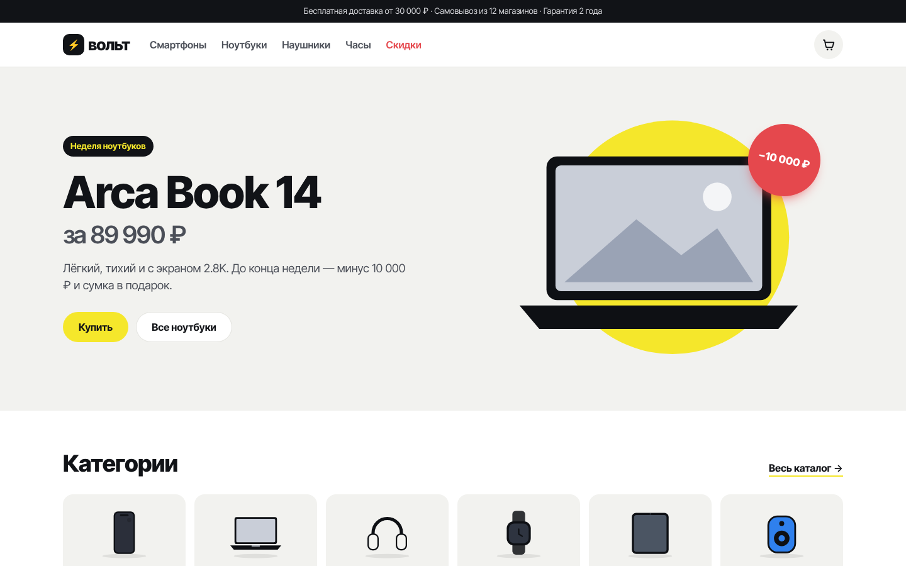
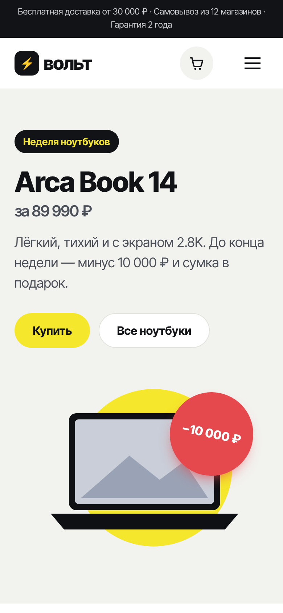

# Вольт — интернет-магазин электроники

**Интернет-магазин (многостраничный)** — демо-шаблон сайта из портфолио.

**[Открыть онлайн →](https://raw.githack.com/legendageniy/projects/site-electronics-store/index.html)**

Магазин электроники с каталогом, фильтрами, карточкой товара, корзиной и оформлением заказа. Товары описаны в одном массиве данных, изображения товаров — генерируемые SVG-иллюстрации, корзина сохраняется в localStorage.

## Возможности

- Каталог с фильтрами по категории, бренду, цене и скидкам; сортировка; состояние фильтров в URL
- Карточка товара: характеристики, выбор количества, похожие товары
- Корзина: изменение количества, удаление, промокод VOLT10, расчёт доставки
- Оформление заказа с валидацией полей и выбором способа получения
- Счётчик товаров в шапке и всплывающие уведомления
- Мобильная панель фильтров и меню

## Страницы

- `index.html` — главная
- `catalog.html` — каталог
- `product.html?id=nord-x5` — карточка товара
- `cart.html` — корзина и оформление

## Мобильная версия

## Технологии

- HTML5, семантическая разметка, доступность (клавиатура, ARIA, контраст)
- CSS3: Grid, Flexbox, custom properties, адаптивная вёрстка от 320 px
- JavaScript без фреймворков и сборки: данные товаров, фильтры, корзина в localStorage, оформление заказа
- Шрифты: Inter Tight — локально, лицензия SIL OFL (`fonts/`)
- Без внешних запросов: иллюстрации — SVG и CSS

## Как запустить

- Онлайн: https://raw.githack.com/legendageniy/projects/site-electronics-store/index.html
- Локально: скачайте ветку (**Code → Download ZIP**) и откройте `index.html` в браузере — сервер и установка не нужны.

---

Демо-проект: компания, люди, цены и контакты вымышлены.

